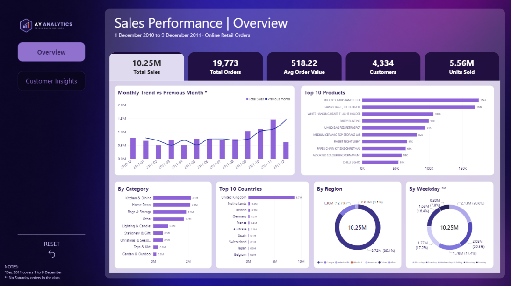
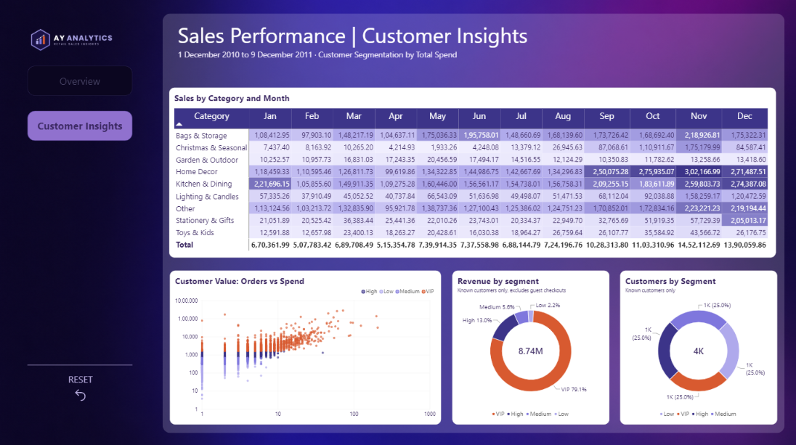

# Sales Performance Dashboard | Online Retail Analysis

An end-to-end sales analysis of a UK-based online gift retailer (1 Dec 2010 – 9 Dec 2011), built with **Python**, **SQL Server** and **Power BI**. The project turns 540K raw transaction rows into a two-page interactive dashboard that answers where revenue comes from, when it peaks and which customers drive it.

## Dashboard Preview

**Page 1: Overview**



**Page 2: Customer Insights**



> The full interactive report is in [`powerbi/sales_performance.pbix`](powerbi/sales_performance.pbix). Open it with Power BI Desktop.

## Business Questions

1. How much revenue does the business generate, and how does it change month to month?
2. Which regions, countries, product categories and products perform best?
3. When do customers buy (season and weekday)?
4. How concentrated is revenue among customers, and how loyal are they?
5. Where are the opportunities to grow?

## Dataset

| Item | Detail |
|---|---|
| Source | "Online Retail" dataset (UCI Machine Learning Repository, also mirrored on Kaggle) |
| Period | 1 Dec 2010 – 9 Dec 2011 (December 2011 is a partial month) |
| Size | 541,909 rows × 8 columns |
| Columns | InvoiceNo, StockCode, Description, Quantity, InvoiceDate, UnitPrice, CustomerID, Country |

## Tools

| Tool | Used for |
|---|---|
| Python (pandas, NumPy) | Data cleaning, feature engineering, customer segmentation |
| SQL Server (T-SQL) | Loading the cleaned data and extracting KPIs and aggregations |
| Power BI + DAX | Data model, measures, interactive dashboard |

## Project Workflow

### 1. Data cleaning (Python): [`notebooks/cleaning.ipynb`](notebooks/cleaning.ipynb)

| Step | What was done | Result |
|---|---|---|
| Duplicates | Dropped exact duplicate rows | 5,268 removed |
| Missing descriptions | Filled from the most common description for the same StockCode, dropped the rest | 1,454 missing values handled |
| Missing CustomerID | Labelled as `Guest` and kept for sales totals, excluded from customer analysis | About 25% of rows |
| Inconsistent text | Standardised case and spacing in descriptions, renamed countries (EIRE → Ireland, RSA → South Africa, USA → United States, Unspecified → Unknown) | |
| Non-product rows | Kept only real product codes (POST, DOT, M, BANK CHARGES, gift vouchers, etc. removed) | |
| Returns | Cancellation invoices (starting with `C`) separated into `returns.csv` | 8,668 rows |
| Invalid values | Removed zero or negative quantity and price | |
| Outliers | Reviewed the largest quantities (see Limitations) | |
| Time features | Year, Month, YearMonth, Weekday, Hour, partial-month flag for Dec 2011 | |
| Region | Mapped 38 countries into 7 regions (UK, Europe, Asia-Pacific, Middle East, Americas, Africa, Other) | |
| Category | Keyword rules on product descriptions into 9 categories | |
| Customer table | Total spend, orders, items, recency, average order value, and spend quartile segment (Low / Medium / High / VIP) | 4,334 customers |

**Output:** `sales_clean.csv` (522,504 rows × 19 columns), `returns.csv`, `customers.csv`.

### 2. SQL extraction and aggregation: [`sql/aggregations.sql`](sql/aggregations.sql)

The cleaned CSVs were imported into a SQL Server database (`SalesDashboard`, tables `dbo.sales` and `dbo.customers`). The script verifies the import and computes:

- Headline KPIs (total sales, orders, average order value, customers)
- Sales by region and by category
- Monthly sales with month-over-month growth (partial month excluded)
- Top 10 products
- Region × month sales (heatmap data)
- Revenue share by customer spend segment
- Repeat vs one-time customers

### 3. Dashboard (Power BI)

**Overview page**
- KPI cards: Total Sales, Total Orders, Average Order Value, Customers, Units Sold, with a metric switcher
- Monthly trend vs previous month
- Top 10 products and top 10 countries
- Sales by category, region and weekday

**Customer Insights page**
- Category × month heatmap (matrix with colour scale)
- Scatter plot of orders vs total spend per customer (log scale)
- Revenue and customer count by spend segment

**Interactivity:** page navigation, cross-filtering between visuals and a reset button. Notes on the page flag the partial December and the missing Saturday data.

## Key Insights

| # | Insight | Evidence |
|---|---|---|
| 1 | **Strong Q4 seasonality** | September to November produce 35% of all revenue in the period. November peaks at £1.45M, about 2.2× the average month from January to August and +32% on October. |
| 2 | **The UK dominates** | The UK contributes £8.72M (85.1%). Europe adds £1.30M (12.7%) and Asia-Pacific just 1.9%. |
| 3 | **Export orders are bigger** | Average order value is about £813 outside the UK against about £487 inside it. The leading export markets are the Netherlands (£284K), Ireland (£271K), Germany (£205K) and France (£184K). |
| 4 | **Three categories carry the business** | Kitchen & Dining (£2.14M), Home Decor (£2.11M) and Bags & Storage (£1.88M) together make up about 60% of revenue. |
| 5 | **Revenue is concentrated in top customers** | The VIP quartile (1,084 customers) generates 79.1% of revenue from identified customers. The top 10% of customers account for 61%. |
| 6 | **Good loyalty base** | About 65% of identified customers placed more than one order, but 1,505 bought only once. |
| 7 | **Clear weekly pattern** | Thursday is the strongest day (£2.13M) and Sunday the weakest (£0.80M). There are no Saturday orders in the data. |
| 8 | **Returns are modest** | Returns are about 4.6% of gross sales, though about half of that value comes from two cancelled bulk orders (see Limitations). |

## Recommendations

1. **Plan for Q4 early.** Build stock and start campaigns from September, since the three months from September to November deliver over a third of revenue.
2. **Grow European exports.** Higher order values in the Netherlands, Ireland, Germany and France suggest wholesale-type buyers. Targeted trade offers could scale this.
3. **Protect and develop VIP customers.** A loyalty or account-management programme for the top quartile protects most of the revenue.
4. **Convert one-time buyers.** Follow-up offers for the 1,505 single-order customers could lift repeat rates.
5. **Capture customer IDs.** About 15% of revenue comes from guest checkouts that cannot be tracked. Encouraging account creation would improve customer analysis.
6. **Test weekend trading.** Sunday revenue is the lowest and Saturday has no orders, so a campaign test could show whether there is unmet demand.

## Repository Structure

```
sales-performance-dashboard/
├── README.md
├── notebooks/
│   └── cleaning.ipynb          # Python data cleaning and feature engineering
├── sql/
│   └── aggregations.sql        # T-SQL import checks and aggregations
├── powerbi/
│   └── sales_performance.pbix  # Power BI report
├── data/
│   ├── sales_clean.zip         # Cleaned sales (zipped, ~82 MB unzipped)
│   ├── returns.csv
│   └── customers.csv
└── images/
    ├── overview.png
    └── customer_insights.png
```

## How to Reproduce

1. Download the Online Retail dataset and save it as `data/data.csv`.
2. Install dependencies: `pip install pandas numpy jupyter`.
3. Update the file paths at the top and bottom of `notebooks/cleaning.ipynb` to point to your `data/` folder, then run all cells. This creates `sales_clean.csv`, `returns.csv` and `customers.csv`.
4. Create a SQL Server database named `SalesDashboard` and import `sales_clean.csv` as `dbo.sales` and `customers.csv` as `dbo.customers` (SSMS: Tasks → Import Flat File). Run `sql/aggregations.sql`.
5. Open `powerbi/sales_performance.pbix` in Power BI Desktop and update the data source paths (Home → Transform data → Data source settings) to your local files, then refresh.

## Limitations

- **Gross sales:** the headline total (£10.25M) is before returns of about £0.48M.
- **Two bulk orders:** invoices 541431 (74,215 jars, £77K) and 581483 (80,995 paper craft units, £168K) were cancelled the next day, but the original sales remain in the sales table. Together they are 2.4% of sales and make "Paper Craft, Little Birdie" appear as the #2 product. Excluding them lowers total sales to about £10.0M and average order value to about £506.
- **Derived categories:** the source has no category field. Categories come from keyword rules on product names, and about 17% of revenue falls into "Other".
- **Derived regions:** regions are a manual grouping of countries.
- **Partial December:** the data ends on 9 December 2011, so the last bar is not comparable to full months.
- **Customer coverage:** customer analysis covers identified customers only. Guest checkouts (about 15% of revenue) are excluded.
- **Short history:** with about 13 months of data, year-over-year comparison is not possible, and seasonality rests on a single year.

## Author

**Ayush Yadav**, Aspiring Data Analyst
[LinkedIn](https://linkedin.com/in/ayush-yadav-914246198)
